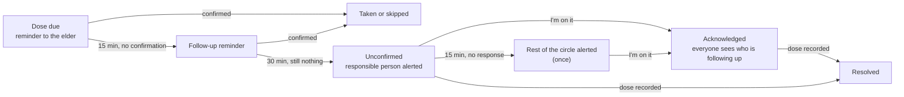
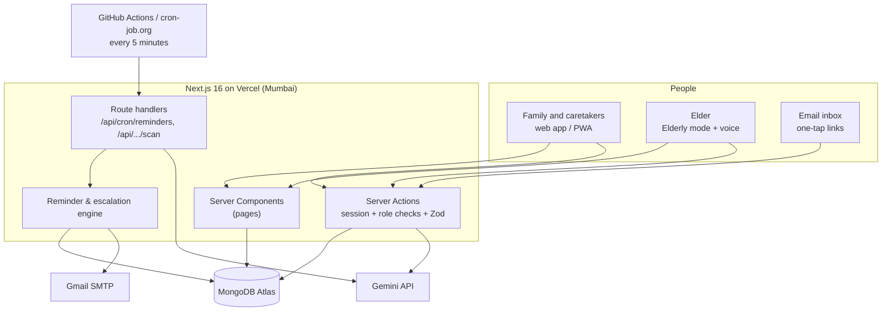

<div align="center">


# Saathi

**Elder care and medication management, together.**

Saathi (“companion”) connects an elderly person, their family and their caretakers in one shared care circle.
It doesn’t stop at reminders: when a dose isn’t confirmed, Saathi makes sure **someone follows up**, and
everyone can see who did what.

**[Open the live app → saathi-murex.vercel.app](https://saathi-murex.vercel.app)**

[](https://github.com/UjjvxL/Saathi/actions/workflows/ci.yml)

</div>

Built for the **PromptWars × Catalyst** hackathon (Google for Developers, *Build with AI*), challenge:
**Elderly Care & Medication Management Platform**.

## Contents

- [The problem](#the-problem)
- [Features](#features)
- [How it works](#how-it-works)
- [Try it in 5 minutes](#try-it-in-5-minutes)
- [Google technologies used](#google-technologies-used)
- [Tech stack and architecture](#tech-stack)
- [Run it locally](#run-it-locally)
- [Testing](#testing)
- [Deploy](#deploy-to-vercel-free)
- [Security and privacy](#security-and-privacy)
- [Accessibility](#accessibility)
- [Limitations and next steps](#limitations-and-next-steps)

## The problem

Many older people take several medicines a day. Their children often live in another city, and a caretaker
may only visit for part of the day. A reminder app can say “it’s time for your tablet”, but nobody knows
whether it was actually taken. When it isn’t, nobody is clearly responsible for checking.

Saathi closes that loop. It gives the elder a simple, voice-first way to stay on track, gives the family
and caretakers one shared view, and turns every unconfirmed dose into a clear, accountable follow-up.

## Features

### 1. Smart missed-medication escalation

- A reminder goes out when a dose is due, with a one-tap **“I’ve taken them”** button that needs no login.
- If nobody confirms the dose within **15 minutes**, a follow-up goes out.
- At **30 minutes** the dose becomes **Unconfirmed**, and the **member responsible** for that medicine is
  alerted with a personal **“I’m on it”** link. Without a responsible member, every caretaker and family
  member is alerted.
- If nobody acknowledges within 15 more minutes, the rest of the circle is alerted, **once**: no repeated loops.
- When someone records what happened, the alert **resolves itself**.
- Every step is timestamped: reminder, follow-up, escalation, who was alerted, who acknowledged and when it
  was resolved. All timings can be changed per elder.
- Saathi **never marks a dose as taken by itself**.

### 2. Care Circle

- Each elder’s profile has a **Care ID** and a **6-digit passcode**. Family and caretakers join with both.
  The passcode is stored only as a bcrypt hash, **expires after 7 days** and can be turned off at any time.
- Roles are **Owner/Elder**, **Caretaker** and **Family**, with permissions enforced on the server (see
  [Roles and permissions](#roles-and-permissions)).
- Medicines and doctor visits can be **assigned to a specific person**.
- The **Care Circle dashboard** shows connected family members, assigned caretakers, pending and completed
  responsibilities, outstanding medication alerts and recent care activity.

### 3. Voice-first Elderly mode

A one-screen mode for the elder (`/elder/<profile>`) with large text and buttons, high contrast, an
**A−/A+** text size control, a big “Call family” button and a prominent microphone.

| Say | Saathi |
| --- | --- |
| “What medicines do I need to take today?” | Reads out today’s medicines, their times and which are done |
| “Have I taken my morning medicines?” | Checks the morning (or afternoon, evening, night) doses |
| “When is my next doctor’s appointment?” | Reads out the next visit |
| “Remind me to take my medicine in 10 minutes” | Sets a spoken reminder (while the screen is open) |
| “I have taken my medicine” | Reads back which dose it means and asks **“Is that right?”**. It only saves after a clear “yes” |

- It uses the browser’s Web Speech API, so there are no paid services.
- It understands a few Hindi words too (*dawai*, *le li*, *haan*, *nahi*).
- It reads reminders aloud while the screen is open.
- Browsers without speech recognition get a typed fallback with quick-question buttons.

### 4. Health Insights

The Insights page answers “how is the routine going?” from **recorded doses only**:

- **Weekly adherence %** and the change from last week.
- Taken, missed, unconfirmed and skipped doses, kept separate.
- A 7-day trend and a dose-by-day history grid.
- **Frequently missed doses** and **recurring patterns** (for example evening doses), over 28 days. A pattern
  is only claimed when there’s enough data.
- Per-medicine history, upcoming visits and recent escalations, including who acknowledged and how fast.
- Plain-English summaries such as “Your medication adherence this week was 92% (23 of 25 doses)”. Each
  summary shows the **period and data used**.
- An optional **Gemini-written summary**:
  - Gemini only receives aggregated numbers, never names or emails.
  - Its answer is rejected if it gives advice, mentions illnesses or invents numbers. Saathi’s rule-based
    summary is shown instead.
- Every Monday the family gets a **weekly summary email**.

Saathi describes routines only. It never diagnoses or suggests medicine changes.

### 5. Accountability timeline

A chronological record of every reminder, follow-up, escalation, acknowledgement, dose update,
responsibility, medicine or appointment change and membership change. Each entry shows the **time, event
type, who did it and the status afterwards**. The timeline can be filtered by date, event type and member,
and comes with an **escalation history** that shows each alert step by step.

### And also

- **AI prescription scan**: Gemini reads a photo of a prescription and fills in the medicines for a person
  to review before anything is saved.
- **Doctor appointments**: reminders ~24 hours and 2 hours before.
- **Pill count**: low-stock alerts.
- **Read aloud** for the day’s medicines, **bigger-text** modes, live updates across family phones.
- **Installable** as an app (PWA) on any phone.

### Challenge requirements → Saathi

| Requirement | How Saathi does it |
| --- | --- |
| Shared ecosystem with secure, passcode-based access | Care ID + hashed 6-digit passcode that expires and can be revoked; rate-limited joining; admins are emailed when someone joins; role-based permissions enforced on the server |
| View, add, edit and manage medication schedules | Medicines with dose, form, instructions, several times a day, daily or chosen weekdays, start/end dates, pill count and a responsible person; AI prescription scan |
| Track adherence | Taken / pending / skipped / missed / unconfirmed per dose with who recorded it; Health Insights |
| Monitor upcoming doctor appointments | Visits with doctor, speciality, address and notes; edit, assign, mark done or cancel |
| Proactive email reminders for missed doses, upcoming doses and appointments | Due-time reminder → follow-up → escalation to the responsible person → widening; appointment and low-stock reminders; weekly summary |
| Smarter, more accessible, reliable and collaborative | Voice-first Elderly mode, accountability timeline, responsibilities, AI insights, send-once emails, 300+ automated tests |
| The elder stays at the centre | The elder is always an admin, can’t be removed by others, is told when anyone joins, and can manage their own day by voice |

## How it works

### Dose statuses

| Status | Meaning | Set by |
| --- | --- | --- |
| Upcoming | Not due yet | Computed |
| Pending | Due and waiting for confirmation (reminders are going out) | Computed |
| Taken | Taken | A person |
| Skipped | Deliberately not taken (for example on a doctor’s advice) | A person |
| Missed | Someone confirmed it was not taken | A person |
| Unconfirmed | Nobody confirmed it by the escalation time | Saathi |

### Escalation



| When *(defaults; admins can change them)* | What happens |
| --- | --- |
| When the dose is due | Elder, caretakers and the responsible person get a reminder with an **I’ve taken them** button. Status: **Pending** |
| Not confirmed after 15 min | Follow-up reminder to the same people |
| Not confirmed after 30 min | The dose is recorded as **Unconfirmed** and the **responsible person** is alerted (or every caretaker and family member if nobody is responsible), each with a personal **I’m on it** link |
| Nobody acknowledged within 15 more minutes | The rest of the circle is alerted, once |
| Someone acknowledges | Everyone sees who is following up; no more alerts |
| The dose is recorded (taken, skipped or not taken) | The alert resolves itself |
| ~24 h and 2 h before an appointment | Everyone in the circle |
| Stock at or below the alert level | Everyone (once a day) |
| Monday morning | A summary of last week for the whole circle |

- A scheduler calls `/api/cron/reminders` every 5 minutes.
- Before anything is sent, each step is claimed in the database, using unique keys and a unique index on
  alerts. Overlapping runs therefore never double-send. If every send fails, the claim is released and the
  next run retries.
- Times follow the elder’s own timezone. Doses scheduled before a medicine was added are never expected.

### Roles and permissions

| Can… | Admin (always includes the elder) | Caretaker | Family |
| --- | :---: | :---: | :---: |
| Confirm doses (taken, skipped or missed) | ✅ | ✅ | ✅ |
| Acknowledge alerts and follow up | ✅ | ✅ | ✅ |
| Add and edit doctor appointments | ✅ | ✅ | ✅ |
| Add and edit medicine schedules | ✅ | ✅ | — |
| Assign responsibilities to members | ✅ | ✅ | — |
| Manage members, invitations and settings | ✅ | — | — |

The rules live in `src/lib/permissions.ts`. Every Server Action and API route enforces them through
`authorizeMember()` in `src/lib/auth/guard.ts`, so hiding a button is never the only check.

### Architecture



### Data model (MongoDB)

| Collection | Holds |
| --- | --- |
| `users` | Name, email, bcrypt password hash, session version |
| `profiles` | The elder’s details, timezone, Care ID, passcode hash and expiry, reminder timings |
| `memberships` | User ↔ profile, role, admin flag, email alerts on/off |
| `medications` | Schedule, instructions, pill count, responsible person |
| `doselogs` | One per dose: taken / skipped / missed / unconfirmed, who recorded it and when |
| `appointments` | Visit details, status, responsible person, who completed it |
| `alerts` | One per escalated dose slot, with every step’s timestamp |
| `activities` | The timeline: who, what, status afterwards, members involved |
| `reminderlogs` | Claims that make every email send-once (expire after 30 days) |
| `ratelimits` | Attempt counters (expire automatically) |

## Try it in 5 minutes

1. Open **[saathi-murex.vercel.app](https://saathi-murex.vercel.app)**, sign up and **create a care
   profile**. Note the Care ID and passcode.
2. Add a medicine due in a few minutes, or **scan a prescription** photo.
3. In a second browser (or a private window), sign up as someone else and **join** with the Care ID and
   passcode as a **caretaker**. Back in the first browser, edit the medicine and make the caretaker
   **responsible** for it.
4. Open **Elderly mode** (button at the top of the profile), tap the microphone and ask *“What medicines do I
   need to take today?”*, then say *“I have taken my medicine”* and *“yes”*.
5. Leave another dose unconfirmed. The follow-up arrives after 15 minutes, and at 30 minutes the caretaker
   gets the alert with **I’m on it**. Watch it on **Care circle** and **Timeline**.
6. After a few days of use, open **Insights**.

## Google technologies used

| Technology | Used for |
| --- | --- |
| **Gemini API** (`@google/genai`, Gemini 3.5 Flash with a fallback model) | Reading prescriptions from photos; the optional weekly insights summary |
| **Web Speech API** (Google speech recognition in Chrome) | The Elderly-mode voice assistant |
| **Gmail** (SMTP) | Reminder, alert, appointment and weekly summary emails |
| **Google Fonts** (`next/font/google`) | Geist and Instrument Serif |
| **Google Cloud Run + Cloud Scheduler** | Alternative deployment ([guide below](#deploy-to-google-cloud-run)) |

## Tech stack

- **Next.js 16** (App Router, Server Components, Server Actions, Partial Prerendering) and **TypeScript**.
- **Tailwind CSS 4**, Geist and Instrument Serif fonts, lucide icons.
- **MongoDB Atlas** with Mongoose.
- **Own authentication**:
  - bcrypt password hashes;
  - a signed JWT session in an httpOnly cookie (jose), with session versioning;
  - rate limiting stored in MongoDB.
- **Nodemailer** (Gmail SMTP) for email.
- **Gemini API** (`@google/genai`) for prescription scanning and summaries.
- **Web Speech API** for voice input and output.
- **Vitest**, **Testing Library**, **mongodb-memory-server**, **Playwright** and **axe-core** for tests.
- Deploys to **Vercel** (free) or **Google Cloud Run** (Dockerfile included). GitHub Actions runs CI and the
  5-minute reminder schedule.

## Project structure

```
src/
  app/
    page.tsx                     Landing page
    (auth)/                      Log in, sign up, forgot / reset password
    (app)/dashboard              Every care circle you belong to
    (app)/profiles/new           Create a care profile (Care ID + passcode shown once)
    (app)/join                   Join with Care ID + passcode
    (app)/p/[profileId]/         One elder's profile:
      page.tsx                     Today: outstanding alerts, dose timeline, read aloud
      medications/                 List, add (scan or manual), edit, responsible person
      appointments/                Upcoming and past visits, edit, who is taking care of it
      circle/                      Care Circle dashboard: alerts, responsibilities, members, invites, roles
      insights/                    Health Insights
      timeline/                    Accountability timeline and escalation history
      settings/                    Reminder timing, email alerts, profile details
    elder/[profileId]/           Voice-first Elderly mode
    confirm/                     "I've taken them" page (from reminder emails)
    alerts/ack/                  "I'm on it" page (from alert emails)
    actions/                     Server Actions (each re-checks session, role and input)
    api/cron/reminders           Reminder & escalation engine endpoint
    api/profiles/[id]/scan       AI prescription reader
    api/auth/                    Logout and expired-session handling
    api/health                   Health check
  components/                    UI kit, dose timeline, alert card, elder/, insights/
  lib/
    auth/                        JWT, sessions, passwords, reset links, data access layer, guards
    permissions.ts               Role → capability rules (server checks and UI)
    reminders.ts                 Reminder & escalation engine
    alerts.ts                    Alert lifecycle: acknowledge, resolve, reopen
    insights-core.ts             Adherence and pattern calculations (pure, unit-tested)
    voice/                       Voice command parsing and replies (pure, unit-tested)
    schedule.ts                  Timezone-aware dose scheduling and statuses
    models.ts, data.ts, dto.ts   Mongoose models, read queries, plain data shapes
    email/                       Email templates, weekly summary, sender
    ai/                          Gemini prescription reader and summary
    validation.ts                Zod schemas for every input
  proxy.ts                       Sends signed-out visitors to log in
tests/
  unit/                          Scheduling, permissions, insights, voice, validation, tokens, emails
  integration/                   Server actions, escalation engine, data and API routes on a real MongoDB
  components/                    Interactive components in jsdom
e2e/                             Playwright journeys + automated accessibility checks
```

## Run it locally

Requirements: Node.js 20.9+ and a MongoDB database.

```bash
npm install
cp .env.example .env.local     # then fill it in (see below)
npm run dev                    # http://localhost:3000
```

### 1. MongoDB Atlas

1. Create a free cluster at [cloud.mongodb.com](https://cloud.mongodb.com).
2. **Database Access**: add a database user with a password.
3. **Network Access**: add your IP. For Vercel or Cloud Run, allow `0.0.0.0/0` (they have no fixed IP).
4. **Connect → Drivers**: copy the connection string into `MONGODB_URI` (put your password in it).

Collections and indexes are created automatically on first use.

### 2. Environment variables

| Variable | Required | What it is |
| --- | --- | --- |
| `MONGODB_URI` | yes | MongoDB Atlas connection string |
| `MONGODB_DB` | no | Database name (default `saathi`) |
| `AUTH_SECRET` | yes | 32+ random characters for signing sessions: `openssl rand -base64 48` |
| `APP_URL` | yes* | Public URL, used in email links. *Optional on Vercel (the production domain is used automatically) |
| `CRON_SECRET` | yes | Secret the scheduler sends to the reminder endpoint: `openssl rand -hex 32` |
| `SMTP_HOST`, `SMTP_PORT`, `SMTP_USER`, `SMTP_PASS`, `EMAIL_FROM` | no | Email sending. Without them, emails are printed to the server console |
| `GEMINI_API_KEY`, `GEMINI_MODEL` | no | AI prescription scanning and insight summaries ([get a key](https://aistudio.google.com/apikey)) |
| `EMAIL_OUTBOX_DIR` | no | Development only: also save previewed emails as JSON files in this folder |
| `REMINDER_INTERVAL_SECONDS` | no | How often the app checks reminders by itself (default 60 in development, off in production) |

**Gmail:**
1. Turn on 2-Step Verification and create an [App Password](https://myaccount.google.com/apppasswords).
2. Set `SMTP_HOST=smtp.gmail.com` and `SMTP_PORT=465`.
3. Use your Gmail address as `SMTP_USER` and the app password as `SMTP_PASS`.

### 3. Reminders locally

During `npm run dev` the app checks reminders by itself every minute (see `src/instrumentation.ts`), so
emails arrive on time locally. You can also click **Settings → Check reminders now** (admins) or run
`npm run reminders:local`. In production a scheduler calls `/api/cron/reminders` instead (see below).

## Testing

**300+ automated tests:**
- 282 unit, integration and component tests.
- 27 end-to-end and accessibility tests in Google Chrome, on desktop and mobile.

They run on every push in GitHub Actions.

| Layer | What it covers | Command |
| --- | --- | --- |
| Unit | Timezone-aware scheduling (incl. daylight saving), dose statuses, permissions, insights calculations, voice commands, validation, tokens, email privacy, security helpers | `npm run test:unit` |
| Integration | Every server action and permission; the escalation engine through every stage, on a fixed clock; acknowledgements; responsibilities; invitations; insights and timeline queries; API routes. Runs against a real in-memory MongoDB with Next.js request APIs mocked | `npm run test:integration` |
| Components | Forms, dose timeline, Elderly mode, scan review, text-size toggle, read aloud, copy, navigation (jsdom + Testing Library) | `npm run test:components` |
| End-to-end | The full family journey; escalation (reminder → follow-up → alert → “I’m on it” from email → dose recorded → timeline); role limits; the voice assistant with simulated speech; insights; password reset; privacy between families | `npm run test:e2e` |
| Accessibility | axe-core WCAG 2.1 AA scans of every page; serious or critical issues fail the build | part of `npm run test:e2e` |

```bash
npm test                            # unit + integration + components
npm run test:coverage               # the same, with a coverage report
npm run build && npm run test:e2e   # end-to-end in Google Chrome (starts its own server and database)
npm run test:all                    # lint, types, all tests, build and end-to-end
```

- Integration and end-to-end tests start a throwaway MongoDB automatically (`mongodb-memory-server`). Set
  `MONGODB_TEST_URI` to use an existing one instead.
- The end-to-end server replays the escalation timeline with a test-only clock override.

## Deploy to Vercel (free)

The live app runs on Vercel’s free Hobby plan. `vercel.json` pins the server functions to Mumbai (`bom1`),
next to the MongoDB Atlas cluster (AWS `ap-south-1`).

1. Push the code to GitHub.
2. On [vercel.com](https://vercel.com), click **Add New → Project** and import the repository. Keep the
   defaults.
3. Under **Environment Variables**, paste your `.env` file (Vercel accepts a whole file at once):
   - use a fresh `AUTH_SECRET` and `CRON_SECRET` for production;
   - leave out `APP_URL`, because the production domain is detected automatically.
4. Click **Deploy**. Check that `https://<your-app>.vercel.app/api/health` shows `"database":"ok"`.
5. In MongoDB Atlas, keep `0.0.0.0/0` in **Network Access**.

### Reminders every 5 minutes

Vercel’s free plan runs cron jobs **once a day** at most, so `vercel.json` registers only a daily backstop.
The 5-minute schedule comes from one of these (both free):

- **GitHub Actions** (already in the repo):
  1. In **Settings → Secrets and variables → Actions**, add the repository secrets `APP_URL` (your live
     address) and `CRON_SECRET` (the same value as in Vercel).
  2. `.github/workflows/reminders.yml` then runs every 5 minutes. Use **Actions → Reminders → Run
     workflow** to test it.
- **cron-job.org**: create a job for `https://<your-app>.vercel.app/api/cron/reminders`, every 5 minutes,
  method `POST`, with the header `Authorization: Bearer <CRON_SECRET>`.

## Deploy to Google Cloud Run

```bash
gcloud run deploy saathi \
  --source . \
  --region asia-south1 \
  --allow-unauthenticated \
  --set-env-vars "MONGODB_URI=...,AUTH_SECRET=...,CRON_SECRET=...,APP_URL=https://<your-service-url>,SMTP_HOST=smtp.gmail.com,SMTP_PORT=465,SMTP_USER=...,SMTP_PASS=...,EMAIL_FROM=Saathi <you@gmail.com>,GEMINI_API_KEY=..."

gcloud scheduler jobs create http saathi-reminders \
  --location asia-south1 \
  --schedule "*/5 * * * *" \
  --uri "https://<your-service-url>/api/cron/reminders" \
  --http-method POST \
  --headers "Authorization=Bearer <CRON_SECRET>"
```

For real deployments, prefer `--set-secrets` with Secret Manager over plain environment variables.

## Security and privacy

**Accounts and access**
- Passwords and passcodes are bcrypt-hashed. Sessions are signed JWTs in httpOnly, SameSite cookies.
- **Role-based permissions** are enforced in every Server Action and API route. Hiding a button is never the
  only check, and people outside a care circle get a 404.
- Invitations expire after 7 days and can be revoked. Joining is rate-limited per Care ID, account and IP,
  and an expired code is only reported after a correct passcode.
- Login, signup, password-reset, scan and AI-summary attempts are rate-limited.
- Resetting a password signs out every other device. Reset links are single-use and expire in 30 minutes.

**Data and input**
- Responsible people must be members of the circle. Doses can only be recorded for genuinely scheduled
  times, and all input is validated with Zod.
- Every important action is recorded in the timeline, which can’t be edited.

**Email**
- **Email subjects and preview text never contain medicine names**, because they show on lock screens.
- Email links are short-lived, single-purpose signed tokens:
  - **“I’ve taken them”**: 12 hours, one time slot.
  - **“I’m on it”**: 24 hours, one alert and one member, who must still be in the circle.
- Opening a link changes nothing; only pressing its button does.

**AI**
- The AI summary only receives aggregated numbers, never names or emails, and its answer is checked
  before it’s shown.

**Hosting**
- API keys stay on the server.
- Security headers: HSTS, X-Frame-Options, nosniff, Referrer-Policy, and a Permissions-Policy that allows
  only the camera and microphone for this site.
- `E2E_ALLOW_CLOCK_OVERRIDE` and `RATE_LIMIT_SCALE` are test-only switches set by `e2e/start-server.mjs`.
  Never set them in production.

## Accessibility

- 18px base text with **bigger** and **extra-large** text modes.
- High-contrast colours (WCAG AA), checked automatically with axe-core on every page.
- 48px+ touch targets (64px+ in Elderly mode).
- Full keyboard support with visible focus.
- Screen-reader labels whose visible text is part of each button’s name.
- A voice assistant and spoken reminders in Elderly mode.
- Read-aloud for the day’s medicines.
- Reduced-motion support.

## Limitations and next steps

- Notifications are email, in-app and spoken (in Elderly mode). Push notifications, SMS or WhatsApp would
  come next.
- Spoken reminders and “remind me” work while Elderly mode is open.
- Voice input works in Chrome, Edge and Safari (Firefox gets the typed fallback). It understands English
  (India) with some Hindi words, and replies are in English.
- Ideas: a Hindi interface, pharmacy refill requests, a report to share with the doctor, and offline support.

> Saathi helps families coordinate care. It doesn’t replace advice from a doctor or pharmacist.
